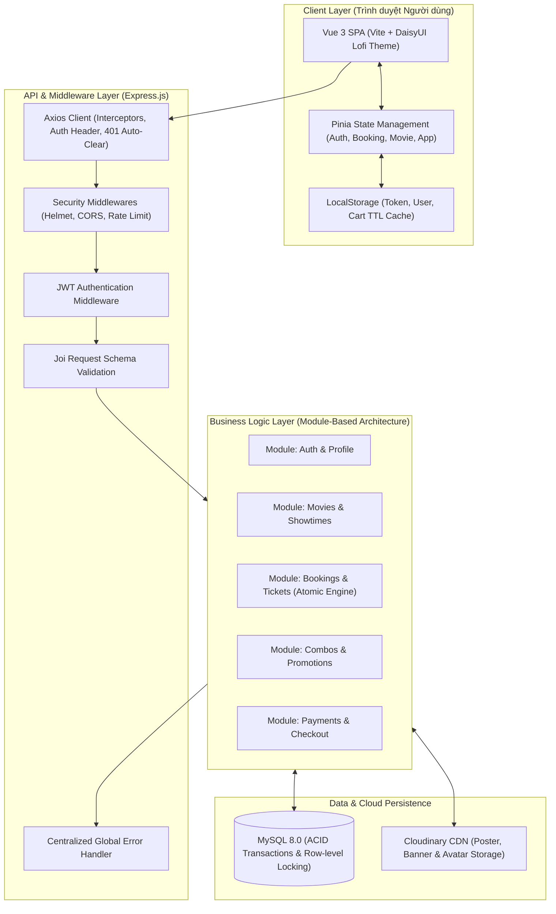
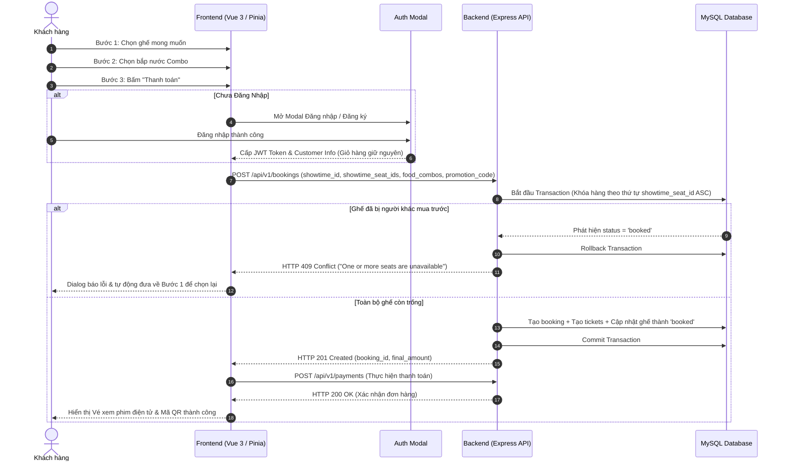

# 🎬 CINE-VUE: FULL-STACK CINEMA TICKETING SYSTEM

> _Hệ thống thương mại điện tử đặt vé xem phim trực tuyến thế hệ mới, kiến trúc Module-Based hiệu năng cao, tối ưu trải nghiệm người dùng với Vue 3, Node.js & MySQL._

[](https://vuejs.org/)
[](https://nodejs.org/)
[](https://expressjs.com/)
[](https://www.mysql.com/)
[](https://tailwindcss.com/)
[](https://pinia.vuejs.org/)
[](https://vitejs.dev/)

🌐 **Trải nghiệm trực tiếp dự án (Live Demo):** [https://fullstack-gamma-indol.vercel.app/](https://fullstack-gamma-indol.vercel.app/)

---

## 1. TỔNG QUAN DỰ ÁN (EXECUTIVE SUMMARY)

### 📌 Bài toán & Định vị

Trong ngành kinh doanh dịch vụ giải trí chiếu phim, trải nghiệm mua vé trực tuyến quyết định trực tiếp đến tỉ lệ chuyển đổi đơn hàng và mức độ trung thành của khách hàng. Nhiều hệ thống đặt vé hiện nay gặp phải các điểm nghẽn nghiêm trọng:

1. **Rào cản gia nhập quá sớm:** Ép buộc khách hàng phải tạo tài khoản hoặc đăng nhập ngay từ bước xem lịch chiếu hoặc chọn ghế, khiến tỉ lệ thoát trang (bounce rate) tăng cao.
2. **Xung đột tài nguyên & Deadlock:** Khi nhiều khách hàng cùng truy cập vào suất chiếu bom tấn và chọn các ghế liền kề, việc khóa bảng hoặc khóa hàng thiếu quy chuẩn dễ gây lỗi xung đột CSDL (_Deadlock found when trying to get lock_).
3. **Mất phiên giao dịch & Trải nghiệm gián đoạn:** Tải lại trang (F5) làm biến mất giỏ hàng, popup trình duyệt (`alert`, `confirm`) làm đứt gãy cảm xúc điện ảnh.

### 💡 Giải pháp từ Cine-Vue

**Cine-Vue** là nền tảng Full-Stack toàn diện được xây dựng nhằm giải quyết triệt để các vấn đề trên thông qua:

- **Phương án 2 (Frictionless Checkout - Đăng nhập ở bước cuối):** Khách vãng lai hoàn toàn tự do khám phá lịch chiếu, tương tác với sơ đồ ghế và chọn combo bắp nước. Đăng nhập chỉ xuất hiện tại bước Thanh toán, bảo toàn 100% dữ liệu giỏ hàng.
- **Cơ chế Đặt vé Nguyên tử (Atomic Seat Booking & Deterministic Locking):** Loại bỏ trạng thái giữ ghế lửng lơ (`held`) gây nghẽn tài nguyên. Khi thanh toán, transaction MySQL khóa các hàng theo thứ tự ID ghế tăng dần (`ORDER BY showtime_seat_id ASC`), **triệt tiêu hoàn toàn nguy cơ Deadlock (ABBA Deadlock)**.
- **Phong cách Thiết kế Tối giản Hiện đại (DaisyUI Lofi Theme):** Sử dụng bảng màu Lofi tương phản cao, giao diện tinh gọn, không màu mè rườm rà, tập trung tối đa vào nội dung phim và thao tác của người dùng.
- **Quản lý Phiên & Dọn dẹp Thông minh:** Tự động giải mã hạn JWT Token, tự động hủy phiên và dọn sạch `localStorage` khi hết hạn phiên đăng nhập ngay cả khi người dùng đang mở tab.

---

## 2. KIẾN TRÚC HỆ THỐNG (FULL-STACK ARCHITECTURE)

Hệ thống được thiết kế theo mô hình tách biệt hoàn toàn giữa **Client-Side Single Page Application (SPA)** và **Server-Side RESTful API Gateway**:



---

## 3. CÔNG NGHỆ CHỦ ĐẠO (TECH STACK SHOWCASE)

| Tầng                    | Công nghệ                         | Vai trò & Giải pháp                                                                          |
| :---------------------- | :-------------------------------- | :------------------------------------------------------------------------------------------- |
| **Front-End Framework** | **Vue 3**                         | Sử dụng 100% cú pháp `<script setup>` (Composition API), tối ưu hóa hiệu năng render DOM ảo. |
| **FE Build Tool**       | **Vite**                          | Máy chủ phát triển HMR cực nhanh (dưới 100ms), đóng gói bundle production siêu tối ưu.       |
| **FE State Management** | **Pinia**                         | Quản lý state theo module (`auth`, `booking`, `movie`, `app`), type-safe và dễ debug.        |
| **FE Styling**          | **Tailwind CSS & DaisyUI 5**      | Bộ công cụ giao diện theo theme `lofi` tối giản, thanh lịch, chuẩn responsive mọi thiết bị.  |
| **FE Routing**          | **Vue Router 4**                  | Điều hướng SPA mượt mà, tích hợp Navigation Guards bảo vệ các trang yêu cầu đăng nhập.       |
| **FE Carousel & UX**    | **Swiper.js**                     | Băng chuyền Poster phim, Swiper chọn ngày theo múi giờ địa phương (`getTimezoneOffset`).     |
| **Back-End Runtime**    | **Node.js (LTS)**                 | Xử lý I/O phi đồng bộ (Non-blocking Asynchronous I/O) cho thông lượng request cao.           |
| **Back-End Framework**  | **Express.js 4.x**                | Bộ khung API gọn nhẹ, tổ chức theo **Module-Based Architecture** (Feature-Based).            |
| **Database Engine**     | **MySQL 8.x**                     | Cơ sở dữ liệu quan hệ mạnh mẽ, bảo đảm tính toàn vẹn giao dịch (ACID compliance).            |
| **DB Driver**           | **`mysql2/promise`**              | Hỗ trợ Promise/Async-Await, Connection Pool và Prepared Statements chống SQL Injection.      |
| **Authentication**      | **JWT (`jsonwebtoken`) & Bcrypt** | Xác thực không trạng thái (Stateless), mã hóa mật khẩu một chiều với Salt rounds = 10.       |
| **Cloud Storage**       | **Cloudinary SDK & Multer**       | Tiếp nhận file tải lên trong bộ nhớ đệm và đẩy trực tiếp lên Cloudinary CDN.                 |

---

## 4. TÍNH NĂNG TRỌNG TÂM (CORE FEATURES DEEP DIVE)

### 4.1. Khám phá Phim & Lịch chiếu thông minh

- Phân loại trực quan: **Phim đang chiếu (Now Showing)** và **Phim sắp chiếu (Coming Soon)** kèm bộ lọc thể loại.
- Bộ chọn ngày chiếu thông minh (`BaseTimeSwiper`): Tự động phát hiện ngày hôm nay, tính toán chuẩn múi giờ địa phương (`getTimezoneOffset`), tự động làm mờ và khóa các suất chiếu đã qua giờ bắt đầu.

### 4.2. Sơ đồ ghế ma trận tương tác (Interactive Seat Map)

- Quản lý linh hoạt nhiều loại ghế: **Ghế Thường (Single)**, **Ghế VIP** và **Ghế Đôi (Couple Seat)**.
- **Thuật toán ràng buộc ghế đôi:** Tự động phát hiện và chọn/hủy đồng bộ theo cặp liền kề hợp lệ, ngăn chặn chọn lẻ một nửa ghế đôi.
- Giới hạn an toàn tối đa 10 ghế/lần đặt nhằm triệt tiêu hành vi đầu cơ vé.
- Trạng thái ghế chỉ gồm 3 trạng thái chuẩn xác: Ghế trống (`Available`), Ghế đang chọn (`Selected`) và Ghế đã bán (`Booked`).

### 4.3. Quy trình Đặt vé Không rào cản (Frictionless Booking Flow)

Quy trình tuân thủ **Phương án 2 (Đăng nhập ở bước cuối)**:

1. **Bước 1 (Chọn ghế):** Khách hàng vãng lai thoải mái xem sơ đồ ghế, phóng to/thu nhỏ (`useSeatMap`), chọn ghế yêu thích và xem tạm tính tiền vé.
2. **Bước 2 (Chọn Combo):** Thoải mái thêm bắp nước, combo đồ ăn kèm bán kèm theo rạp.
3. **Bước 3 (Thanh toán & Đăng nhập):**
   - Người dùng chưa đăng nhập: Modal Đăng nhập/Đăng ký tự động mở ra với thông báo thân thiện. Giỏ hàng (ghế + combo) được bảo toàn 100%.
   - Đăng nhập thành công: Khách áp mã giảm giá (Voucher), chọn phương thức thanh toán (Thẻ, MoMo, VNPay, ZaloPay, ShopeePay), đồng ý điều khoản và hoàn tất.



### 4.4. Kiểm soát Đồng thời & Triệt tiêu Deadlock (Deadlock-Free Concurrency Engine)

- **Loại bỏ trạng thái giữ ghế lửng lơ (`held`):** Không còn tình trạng ghế bị treo tạm thời, không cần cronjob nền dọn dẹp liên tục quét bảng CSDL.
- **Deterministic Lock Ordering:** Mọi danh sách ID ghế gửi lên server đều được sắp xếp theo chiều tăng dần số học:
  ```javascript
  const showtimeSeatIds = [...rawSeatIds].map(Number).sort((a, b) => a - b);
  ```
  Câu lệnh SQL khóa hàng:
  ```sql
  SELECT showtime_seat_id, seat_id, price, status
  FROM showtime_seats
  WHERE showtime_id = ? AND showtime_seat_id IN (?)
  ORDER BY showtime_seat_id ASC
  FOR UPDATE;
  ```
  Mọi giao dịch cạnh tranh đều xin khóa tài nguyên theo cùng một chiều, loại bỏ hoàn toàn hiện tượng khóa chéo chu trình (**ABBA Deadlock**).

### 4.5. Bảo mật & Quản lý Phiên Đăng nhập Tự động

- **Giải mã Token JWT tại Client (`parseJwtPayload`):** Đọc trực tiếp trường `exp` từ payload của JWT Token mà không cần thư viện cồng kềnh.
- **Tự động dọn dẹp khi mở web (`checkAuth`):** Nếu mở web sau khi token đã quá hạn, hệ thống tự động xóa sạch `token` và `user` khỏi `localStorage`, đưa về trạng thái chưa đăng nhập an toàn.
- **Hẹn giờ Đăng xuất Tự động (`scheduleAutoLogout`):** Khi người dùng đang mở tab, hệ thống tính toán thời gian sống còn lại của token và hẹn giờ `setTimeout`. Đúng thời điểm hết hạn, hệ thống tự động đăng xuất và bắn thông báo Toast cảnh báo người dùng.
- **Đồng bộ mã lỗi 401 qua Axios Interceptor:** Khi có bất kỳ request nào bị server trả về HTTP 401, hệ thống ngay lập tức xóa dữ liệu xác thực lưu trữ và đồng bộ hóa trạng thái Store toàn cục.

---

## 5. CẤU TRÚC THƯ MỤC TOÀN HỆ THỐNG (PROJECT STRUCTURE)

Dự án được tổ chức theo cấu trúc Monorepo phân định rõ ràng giữa Client và Server:

```text
cine-vue/
├── frontend/                     # ỨNG DỤNG FRONT-END (VUE 3 SPA)
│   ├── src/
│   │   ├── _services/            # Tầng HTTP: Axios client, cấu hình interceptors, auth headers
│   │   ├── assets/               # CSS tokens (DaisyUI, Tailwind), icon hệ thống, ảnh tĩnh
│   │   ├── components/
│   │   │   ├── common/           # Component dùng chung (BaseIcon, BaseLoading, BasePagination...)
│   │   │   ├── features/client/  # Component nghiệp vụ (BookingAction, SeatGrid, MovieTicket...)
│   │   │   └── layout/           # Bố cục giao diện (Header, Footer, GlobalToast, GlobalDialog...)
│   │   ├── composables/          # Hooks logic tái sử dụng (useSeatMap.js, usePagination.js...)
│   │   ├── layouts/              # Master layouts (ClientLayout.vue)
│   │   ├── router/               # Vue Router 4, cấu hình Navigation Guards
│   │   ├── stores/               # Pinia Stores phân tầng (auth, booking, movie, app)
│   │   ├── utils/                # Hằng số (regex.js, paymentData.js) & Helpers (storage.js)
│   │   ├── views/client/         # Các trang màn hình (Home, Movie, Showtimes, Booking, Profile...)
│   │   ├── App.vue               # Root Component
│   │   └── main.js               # Entry point khởi tạo ứng dụng
│   ├── package.json
│   ├── vite.config.js
│   └── README.md                 # Tài liệu kỹ thuật chi tiết Front-End
│
├── backend/                      # ỨNG DỤNG BACK-END (NODE.JS / EXPRESS RESTFUL API)
│   ├── bin/                      # Entry point khởi tạo HTTP server qua http.createServer
│   ├── sql/                      # Script DDL MySQL (lean_ticketing_schema.mysql.sql)
│   ├── src/
│   │   ├── modules/              # 14 Module tính năng độc lập (Auth, Movies, Showtimes, Bookings...)
│   │   │   └── [feature]/        # Mỗi module gồm: *.routes.js, *.controller.js, *.service.js, *.repository.js
│   │   ├── routes/               # Điểm tập hợp toàn bộ routes module vào tiền tố /api/v1
│   │   └── shared/               # Thành phần dùng chung (MySQL Pool, Cloudinary, Middlewares, AppError)
│   ├── app.js                    # Cấu hình Express app, gắn Cors, Helmet, RateLimit, ErrorHandler
│   ├── package.json
│   └── README.md                 # Tài liệu kỹ thuật chi tiết Back-End
│
├── package.json                  # Root package.json điều phối chạy đồng thời Client & Server
└── README.md                     # Tài liệu tổng quan toàn bộ dự án Full-Stack
```

---

## 6. HƯỚNG DẪN CÀI ĐẶT & VẬN HÀNH (GETTING STARTED)

### 📋 Yêu cầu tiên quyết

- **Node.js:** Phiên bản `>= 18.x` (khuyến nghị Node 20 LTS)
- **MySQL Server:** Phiên bản `>= 8.0`
- **Package Manager:** `yarn` (khuyến nghị) hoặc `npm`

---

### Bước 1: Clone kho mã nguồn

```bash
git clone https://github.com/MrEdgarr/Fullstack.git
cd cine-vue
```

---

### Bước 2: Cài đặt phụ thuộc (Dependencies)

```bash
# 1. Cài đặt các gói điều phối tại thư mục gốc
yarn install

# 2. Cài đặt phụ thuộc cho Frontend
cd frontend && yarn install

# 3. Cài đặt phụ thuộc cho Backend
cd ../backend && yarn install

# Quay lại thư mục gốc
cd ..
```

---

### Bước 3: Cấu hình Cơ sở dữ liệu & Biến môi trường

#### 1. Khởi tạo Database MySQL

Đăng nhập vào MySQL CLI hoặc mở MySQL Workbench / DBeaver và chạy file DDL:

```bash
mysql -u root -p < backend/sql/lean_ticketing_schema.mysql.sql
```

#### 2. Thiết lập cấu hình Backend (`backend/.env`)

Tạo file `backend/.env` dựa trên mẫu:

```env
PORT=3000
NODE_ENV=development

# Cấu hình kết nối MySQL
DB_HOST=localhost
DB_PORT=3306
DB_NAME=bmproaxruvzmbuk6hxwj
DB_USER=root
DB_PASSWORD=your_mysql_password
DB_TIMEZONE=Z

# Cấu hình JWT
JWT_SECRET=cinema-secret-key-2026
JWT_EXPIRES_IN=1h

# Cấu hình CORS
FRONTEND_URLS=http://localhost:5173,http://127.0.0.1:5173

# Cấu hình Cloudinary (Lưu trữ ảnh tải lên)
CLOUDINARY_CLOUD_NAME=your_cloudinary_name
CLOUDINARY_API_KEY=your_cloudinary_key
CLOUDINARY_API_SECRET=your_cloudinary_secret
```

#### 3. Thiết lập cấu hình Frontend (`frontend/.env`)

Tạo file `frontend/.env`:

```env
VITE_API_BASE_URL=http://localhost:3000/api/v1
VITE_API_TIMEOUT_MS=60000
```

---

### Bước 4: Khởi chạy dự án

#### Cách 1: Khởi chạy cả Frontend và Backend bằng 1 lệnh duy nhất (Khuyến nghị)

Tại thư mục gốc `cine-vue/`, chạy:

```bash
yarn dev
```

> Lệnh sẽ sử dụng `concurrently` để chạy song song:
>
> - **Backend API:** `http://localhost:3000` (API endpoint: `/api/v1`)
> - **Frontend SPA:** `http://localhost:5173`

#### Cách 2: Khởi chạy riêng lẻ từng phần

- **Chỉ chạy Backend:**
  ```bash
  yarn backend
  # hoặc: cd backend && yarn dev
  ```
- **Chỉ chạy Frontend:**
  ```bash
  yarn frontend
  # hoặc: cd frontend && yarn dev
  ```

---

### Bước 5: Đóng gói kiểm thử Production (Build Test)

```bash
# Đóng gói ứng dụng Frontend
cd frontend
yarn build
```

> Thời gian đóng gói hoàn tất chỉ trong ~1.5 giây với 0 lỗi cú pháp.

---

## 7. QUY CHUẨN KỸ THUẬT & CHẤT LƯỢNG MÃ NGUỒN (ENGINEERING EXCELLENCE)

1. **Tuân thủ quy chuẩn Multi-word Component:** Mọi component Vue đều đặt tên theo chuẩn PascalCase đa từ (`BookingAction.vue`, `BasePagination.vue`, `ProfileHistoryTab.vue`).
2. **Tách biệt Logic Phức tạp ra Composables:** Không nhồi nhét logic vào template; toàn bộ thuật toán sơ đồ ghế (`useSeatMap.js`), phân trang linh hoạt (`usePagination.js`) đều được trừu tượng hóa thành composable độc lập.
3. **Phòng chống tấn công Web Phổ biến:**
   - **SQL Injection:** 100% câu truy vấn dùng Prepared Statements với tham số `?`.
   - **XSS & Clickjacking:** Tích hợp `helmet` headers bảo mật ở tầng Gateway.
   - **DoS / Brute-force:** Bọc middleware `express-rate-limit` giới hạn tần suất request.
4. **Chiến lược Zero-Crash & Phản hồi Chuẩn hóa:** Toàn bộ API đều trả về cấu trúc JSON nhất quán:
   ```json
   {
     "success": true,
     "statusCode": 200,
     "data": { ... },
     "message": "Thao tác thành công"
   }
   ```

---

## 8. ĐỊNH HƯỚNG MỞ RỘNG (FUTURE ROADMAP)

- [ ] **Cổng thanh toán Trực tiếp:** Tích hợp SDK Sandbox thanh toán thực tế (VNPAY QR, MoMo Payment Gateway, PayOS).
- [ ] **Ứng dụng Di động PWA:** Hỗ trợ Progressive Web App cho phép quét vé offline và nhận thông báo nhắc giờ chiếu.
- [ ] **Phân tích Doanh thu & Báo cáo:** Xây dựng Dashboard Admin chuyên sâu với biểu đồ trực quan hóa dữ liệu bán vé.

---

## 👨‍💻 TÁC GIẢ & BẢN QUYỀN (AUTHOR & LICENSE)

- **Dự án:** Cine-Vue Full-Stack Cinema Ticketing System
- **Tác giả:** [MrEdgarr](https://github.com/MrEdgarr)

---

_Dự án được hoàn thiện với tinh thần cẩn trọng, kỷ luật kỹ thuật cao, hướng đến hiệu năng vượt trội và trải nghiệm người dùng hoàn hảo._
